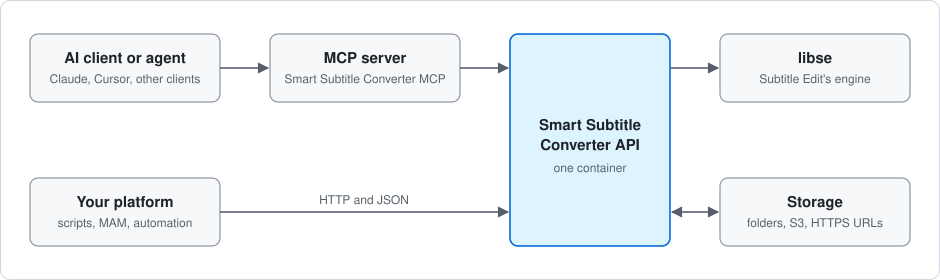

# Smart Subtitle Converter MCP

[](https://github.com/Wauter/smart-subtitle-converter-mcp/actions/workflows/ci.yml)
[](LICENSE)

**An MCP server for converting and checking subtitles from Claude, Cursor or any other MCP client.**

It handles SRT, WebVTT, TTML, ASS and broadcast formats such as EBU STL, PAC and Cavena 890. The agent is told
whether anything was lost in the conversion and which setting fixes it. Files are passed by path, so subtitle
text never enters the model's context.

> **Built on Subtitle Edit.** Conversions run in the
> [Smart Subtitle Converter API](https://github.com/Wauter/smart-subtitle-converter-api), which wraps `libse`, the
> library behind [Subtitle Edit](https://github.com/SubtitleEdit/subtitleedit) by **Nikolaj Olsson** (MIT).
> This is a community project, **not an official Subtitle Edit project**.
>
> **Early software.** Expect changes, and please
> [report issues](https://github.com/Wauter/smart-subtitle-converter-mcp/issues).

## How it works



The MCP server does no conversion itself. It passes requests to the API, which runs in a container,
and handles the files on your machine. If you want to call the converter from your own platform instead of an AI
client, use the [API](https://github.com/Wauter/smart-subtitle-converter-api) directly.

## What you get

- **A verdict on every broadcast output.** EBU STL, PAC and the other binary outputs are read back and reported
  as `lossless`, `quantised`, `lossy` or `unverified`. Warnings carry a `hint` and structured `details`, such as a
  `remedy` for lost characters.
- **Subtitle text stays out of the model.** Files go by `path`. Content, keys and tokens are never logged.
- **Access to named folders only.** The server reads and writes inside the folders you set
  (`SUBTITLE_MCP_ALLOWED_DIRS` / `SUBTITLE_MCP_READONLY_DIRS`). Read-only folders stay read-only.
- **Subtitle files only.** It reads, lists and writes only files with a subtitle extension, never touches hidden
  files or folders (names starting with `.`), and never follows symbolic links
  ([security](docs/security.md#allowed-folders)).
- **Atomic writes.** Single files are staged and committed with a rename. Existing files are never overwritten
  unless you allow it.
- **Errors the agent can act on.** Each has a stable `code`, a `hint` and, for path errors, the allowed folders.
  With a broken setup the server still starts and every tool reports what to fix, so the agent doesn't just see a
  closed connection.

## Quick start (Claude Code)

**1. Start the API.** Its [quick start](https://github.com/Wauter/smart-subtitle-converter-api#quick-start) serves
`http://localhost:8080` and writes an API key to `api_keys.txt`.

**2. Give the MCP the key.** Open the API's `api_keys.txt` (it belongs to the API's container user, so you may
need `sudo cat api_keys.txt`) and save the key in a file of your own, for example `~/subtitle-api-key.txt`, with
nothing else in it. Keep that file private (`chmod 600`).

**3. Add the server.** Point `SUBTITLE_MCP_ALLOWED_DIRS` at the folder that holds your subtitles:

```bash
claude mcp add \
  --env SUBTITLE_API_URL=http://localhost:8080 \
  --env SUBTITLE_API_KEY_FILE=/Users/me/subtitle-api-key.txt \
  --env SUBTITLE_MCP_ALLOWED_DIRS=/Users/me/Subtitles \
  --transport stdio \
  smart-subtitle-convert -- npx -y smart-subtitle-converter-mcp
```

`SUBTITLE_API_KEY=<key>` works too. Without a key, conversions fail with `unauthorized`.

**4. Ask for a conversion:**

> Convert `movie123.srt` in `/Users/me/Subtitles` to EBU STL

> Convert `movie123.srt` in `/Users/me/Subtitles` to EBU STL, place it in `s3://customer1/2026-11-12/`

The second one needs that bucket in the API's
[storage allowlist](https://github.com/Wauter/smart-subtitle-converter-api/blob/main/docs/configuration.md#jobs-and-storage).

Claude Desktop, Cursor, Windows, a VM, or building from source: see [docs/clients.md](docs/clients.md).

## Supported subtitle formats

| | Formats |
|---|---|
| **Text, read and write** | SRT, WebVTT, ASS/SSA, TTML/DFXP, SBV, SMI and Subtitle Edit's other text formats |
| **Editing and post-production** | Final Cut Pro XML captions (`.fcpxml`), and marker lists from Avid and EDIUS |
| **Binary broadcast, read and write** | EBU STL, PAC, FPC, Cavena 890, CapMaker Plus, Cheetah CAP |
| **Binary, read only** | Avid STL, Ayato, Spruce STL and others |
| **Not supported** | Image-based and container formats (Blu-ray sup, VobSub, Matroska, MP4) |

The `list_formats` tool has the live list. Code pages, frame rates and detection rules are in the API's
[formats page](https://github.com/Wauter/smart-subtitle-converter-api/blob/main/docs/formats.md), and Subtitle
Edit's [supported formats](https://subtitleedit.github.io/subtitleedit/reference/supported-formats.html) page
describes the formats themselves.

## Tools

| Tool | What it does |
|---|---|
| `convert_subtitle` | Convert one file (`path`, inline, or API `input`) to inline, local output, or API `output` |
| `detect_format` | Format, encoding, BOM, line endings and language of a file |
| `list_formats` | Formats with read/write and text/binary flags |
| `list_presets` / `get_profile` | Built-in and mounted presets, raw and resolved |
| `validate_profile` | Check a profile, with pointer-level errors and hints |
| `preview_text` | Read the text of an API job's stored input or output, or of a file by location, page by page (binary formats shown as SRT) |
| `list_files` | List a local folder or an API storage location, page by page (`SUBTITLE_MCP_LIST_ENABLED=false` hides it) |
| `list_allowed_folders` | The folders in effect right now, with mode and source; with browsing on, also the API's storage locations |

Inputs, results and warning fields: [docs/tools.md](docs/tools.md).

## API storage and job tracking

- **API locations.** Besides local files, `convert_subtitle` can hand the API its own `input` and `output`
  locations (an allowlisted folder on the API server, an S3-compatible bucket or an HTTPS URL), with an optional
  `sidecar` JSON next to the output. `detect_format` accepts `input` too. These are resolved by the API with its
  own allowlists, separately from the MCP's local folders.
- **No silent overwrites.** Outputs are never overwritten unless you send `ifExists: "replace"`. One file per call.
- **Jobs.** Every conversion returns a `jobId`. When work outlasts the wait, the MCP polls the job. The API keeps
  metadata only, so use an API `output` location for work that may take a while.
- **Previewing.** `preview_text` reads the text of a job's stored input or output, in pages that end on whole
  cues, while the API still has its record.
- **Browsing.** `list_files` lists a folder and `preview_text` reads a file by its full URI or path. The API's
  storage is browsable whenever the API allows it (its default)
  ([browsing](docs/tools.md#browsing-and-reading-by-location)).
- **Inline results.** Without any output location, `convert_subtitle` attaches the whole converted file to its
  result for the client to save.

See [tools](docs/tools.md#api-storage-and-job-ids),
[configuration](docs/configuration.md#api-storage-and-asynchronous-jobs) and
[writing files](docs/writing-files.md#api-destinations-are-separate).

## Safeguards

The usual setup is stdio: the server talks to one local client, not the network. It has not been independently
audited, and it is meant for a trusted environment, not the public internet. Details:
[docs/security.md](docs/security.md) and the API's
[security notes](https://github.com/Wauter/smart-subtitle-converter-api/blob/main/docs/security.md).

## Documentation

| Read this | When you want to |
|---|---|
| [docs/clients.md](docs/clients.md) | Set it up in Claude Code, Claude Desktop, Cursor, Windows or a VM; build from source |
| [docs/folders-and-roots.md](docs/folders-and-roots.md) | Understand which folders it may use |
| [docs/tools.md](docs/tools.md) | See every tool's inputs, results, verification and warning fields |
| [API errors and warnings](https://github.com/Wauter/smart-subtitle-converter-api/blob/main/docs/errors.md) | Look up what an API error or warning means, why it happened and what to do |
| [docs/writing-files.md](docs/writing-files.md) | Know how files are staged and committed, `ifExists`, race windows |
| [docs/configuration.md](docs/configuration.md) | Look up every `SUBTITLE_MCP_*` variable and flag |
| [docs/security.md](docs/security.md) | See allowed folders, writes, API keys and HTTP-mode safeguards |
| [docs/http-sidecar.md](docs/http-sidecar.md) | Run it over Streamable HTTP next to the API in Docker |
| [docs/troubleshooting.md](docs/troubleshooting.md) | Fix MCP-local errors (folders, writes, talking to the API); API codes are on the errors and warnings page above |
| [docs/development.md](docs/development.md) | Build, test, run the contract suite and the smoke checklist |
| [CHANGELOG.md](CHANGELOG.md) | See what changed in each version |

**Versions:** use the MCP release whose major.minor matches your API; patch versions may differ. On a mismatch the
server adds an `mcp-api-version-mismatch` warning.

## Feedback and author

Bug reports are welcome, especially with the file and the client involved:
[open an issue](https://github.com/Wauter/smart-subtitle-converter-mcp/issues).

Built by [Wauter De Bruyne](https://www.linkedin.com/in/wauterdebruyne/), a solution architect working on media
workflow automation for broadcasters, sports organisations and streaming platforms.

## Credits and license

All subtitle format support comes from [Subtitle Edit](https://github.com/SubtitleEdit/subtitleedit) and its
`libse` library by Nikolaj Olsson and contributors (MIT), through the
[Smart Subtitle Converter API](https://github.com/Wauter/smart-subtitle-converter-api).

This server is MIT licensed, see [LICENSE](LICENSE).
